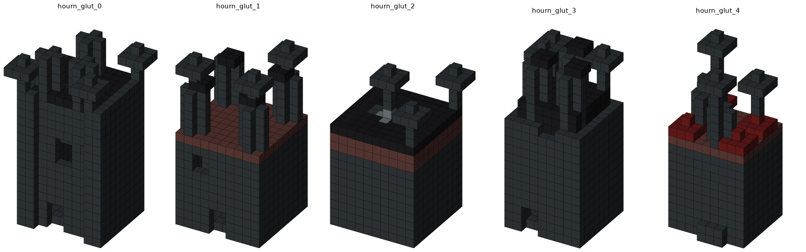

# voxelate

POI or archetype + region/world lore + palette → LLM writes a small primitive spec → deterministic compiler → `VoxelObjectPlan` JSON (12x12x20 max) + PNG preview.



*Five variants of one POI ([inputs/hourn_glut.md](inputs/hourn_glut.md)) with its region lore ([inputs/shattered_maw.lore.json](inputs/shattered_maw.lore.json)), gothic theme. Every voxel uses the region's 7-color palette.*

```powershell
uv run python voxgen.py outpost     # one archetype -> outputs/objects/outpost.{json,spec.json,png}
uv run python voxgen.py --all       # all 13 archetypes
uv run python voxgen.py --poi inputs\hourn_glut.md --lore inputs\shattered_maw.lore.json --theme gothic -n 5 --out outputs\poi  # the sheet above
```

## Commands

```powershell
# generate
uv run python voxgen.py outpost                         # one archetype
uv run python voxgen.py --all                           # all 13 archetypes
uv run python voxgen.py --all -n 3                      # 3 variants each -> outpost_0..2 (plain run overwrites outpost.json)
uv run python voxgen.py --archetype outpost --description "a cliffside watchtower" --regional-lore "built by miners to guard the northern pass" --world-lore "the old empire used blue-glass beacons"
uv run python voxgen.py --description "a windmill" --name windmill # free-form description, no archetype
uv run python voxgen.py --description "an old castle" --name castle --theme gothic
uv run python voxgen.py --description "a watchtower with an accent in #1f165e" # exact hex color
uv run python voxgen.py --description "a traditional Japanese building" --name japanese_building --allowed-colors "#2F3538,#1C1C1E,#5C3A35,#70777A,#6A1B1B,#9E2A2B,#D4A373"
uv run python voxgen.py dungeon --description "A lone pristine basalt fortress on a jagged coast, haunted by shipwrecks and choked in ash-fog." --name hourn_glut --theme gothic --out outputs\poi --allowed-colors "#2F3538,#1C1C1E,#5C3A35,#70777A,#6A1B1B,#9E2A2B,#D4A373"

# themes: fantasy (default), gothic, middle_earth, cyberpunk, scifi_fantasy
uv run python voxgen.py --all -n 3 --theme scifi_fantasy -o outputs/scifi_fantasy

# output folder (default outputs/objects; use -o/--out to choose another)
uv run python voxgen.py outpost -o outputs/test

# no LLM calls
uv run python voxgen.py --rerender                      # rebuild PNGs + sheet from existing .json
uv run python voxgen.py --sheet                         # rebuild _sheet.png only
uv run python voxgen.py outpost --pick 42 3 7           # deterministic spec pick + blit onto test terrain

# viewer (scans outputs/ recursively) -> http://localhost:8000
python viewer.py
```

`--poi` reads a point-of-interest block in either the world generator's plain `Key: value` form or Markdown (`**Key:** value`, `## From outside`). It takes the title, archetype, scale, function, condition, verticality, traits, level, danger, region, the `From outside` paragraph, the `Carries to the road` lines, and the room/passage counts from `Inside:`. The `structure=` id seeds the RNG, so the same POI always compiles to the same model. The POI title becomes the output filename; `--name` overrides it.

`--lore` reads a JSON file with optional `world` and `region` objects, which carry how each looks and the region's color palette:

```json
{
  "world":  {"name": "Shinkuro", "appearance": "...", "architecture": "..."},
  "region": {"name": "Shattered Maw", "appearance": "...", "culture": "...",
             "materials": ["basalt", "driftwood"], "palette": ["#2F3538", "#1C1C1E"]}
}
```

```powershell
uv run python voxgen.py --poi inputs\hourn_glut.md --lore inputs\shattered_maw.lore.json --theme gothic --out outputs\poi
```

`-n 5` writes `hourn_glut_0..4`, seeded with the POI's seed + 0..4. `--seed` overrides the POI's seed. Every description/POI run ends by rebuilding `_sheet.png` in the output folder.

Use `--archetype` to categorize a hand-written description and provide `--description`, `--regional-lore`, and `--world-lore` as separate inputs. The original positional archetype syntax and `-p`/`--prompt` description alias are also supported.
Explicit `#RRGGBB` colors are applied to the named roof, wall, trim, or accent; if no part is named, the color is applied to accents. `--allowed-colors` accepts a comma-separated palette and restricts every generated voxel to one of those colors.

Archetype generation includes a recipe with a required silhouette and core features (for example, an outpost is a narrow watchtower with supports, a lookout, roof cap, and entrance). Gothic theme models also get three grounded, pointed spires added to the compiled structure. Description and lore add context while the recipe anchors the overall shape. Hand-made cave and natural templates remain unchanged.

Needs `OPENAI_API_KEY` in `.env`. Set `VOXGEN_PROVIDER=ollama` (+ `OLLAMA_MODEL`) to use a local model instead.

## Game integration

`voxgen.generate(...)` is the entry point. It takes the five cutouts, returns the plan in memory, and writes files only when `out_dir` is given.

```python
import voxgen

result = voxgen.generate(
    poi,                                  # POI, a dict, or the raw POI text block
    region=voxgen.RegionLore(             # how this region looks and what it builds with
        name="Shattered Maw",
        appearance="black basalt sea-needles rising from cold surf, ash-fog on the ground",
        culture="scavenger crews who build from whatever washes up",
        materials=("basalt", "driftwood", "salvaged iron"),
        palette=("#2F3538", "#1C1C1E", "#5C3A35", "#70777A"),
    ),
    world=voxgen.WorldLore(               # how the world looks overall
        name="Shinkuro",
        appearance="a drowned world of volcanic shelves under permanent overcast",
        architecture="heavy masonry braced with scavenged metal",
    ),
    palette=None,                         # explicit colors; falls back to region, then world
    archetype=None,                       # defaults to the POI's archetype
    theme="gothic",
    seed=None,                            # defaults to the POI's structure id
)

result["plan"]     # {"brief_summary": ..., "voxels": [{x, y, z, material}, ...]}
result["grid"]     # {(x, y, z): material}, ready for blit()
result["spec"]     # the primitive spec plus the prompt that produced it
voxgen.blit(world, result["grid"], origin, ground_fn, voxgen.get_theme("gothic"))
```

The five cutouts:

| Cutout | Argument | What it contributes |
|---|---|---|
| POI | `poi` | archetype, scale, function, condition, verticality, traits, level/danger, interior size, the `From outside` description; `structure_id` seeds the RNG |
| Regional lore | `region` | terrain and weather, who builds here, local materials, region palette |
| World lore | `world` | world appearance and dominant architecture, fallback palette |
| Colors | `palette` | `#RRGGBB` list; every voxel is restricted to it. `palette` > `region.palette` > `world.palette` |
| Archetype | `archetype` | picks the kind, mood tags, and required-silhouette recipe |

`POI` accepts three forms: `voxgen.POI.from_text(block)` for the generator's text, `voxgen.POI.from_dict(d)` for structured data (unknown keys ignored), or the dataclass directly. Pass a `str` or `dict` to `generate()` and it converts for you.

Generation is deterministic given a seed: the same POI picks the same kind, the same template, and sends the same `seed` to the model.

## How it works

Everything is in [voxgen.py](voxgen.py):

- **Spec** (what the LLM writes): `box`, `hollow_box` (closed shell), `column`, `pyramid`, `sphere`, `wedge`, `cylinder`, `erase` (doors/windows only) parts with a material.
- **Compiler**: applies parts in order, clamps to bounds, maps unknown materials to `stone`, strips any self-made ground plate (the game lays its own terrain), drops floating pieces to the ground, and keeps only the largest face-connected component.
- **Colors**: explicit `#RRGGBB` colors and `--allowed-colors`/palettes are written straight into `material`. [viewer.py](viewer.py) renders hex materials as-is.
- **Templates**: `cave`, `skull`, `tree`, `boulder` are hand-made specs, not LLM output (`TEMPLATES`).
- **Output**: `{"brief_summary", "voxels": [{x,y,z,material}]}`.

The old TRELLIS text-to-mesh pipeline lives in [_misc/](_misc/).
